# StockWearOS

A watch-native NSE/BSE stock ticker for circular Wear OS displays.

Built for the **OnePlus Watch 2R** (466×466 round AMOLED, Wear OS 4) and correct
on any round Wear OS 3+ watch. Kotlin + Jetpack Compose for Wear OS, Room,
WorkManager. No account, no paired phone app, no server required — the watch
fetches market data itself.

<p align="center">
  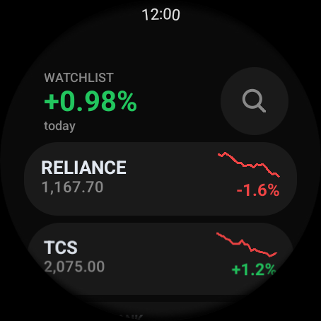
  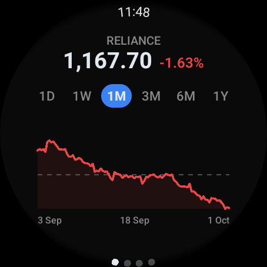
  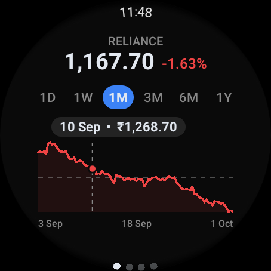
</p>

---

## Install

Download **[`release/stocks-release-v1.2.0.apk`](release/stocks-release-v1.2.0.apk)** (2.67 MB, signed).

On the watch, once:

1. Settings → System → About → tap **Build number** 7 times.
2. Settings → Developer options → enable **ADB debugging** and **Wireless debugging**.
3. Put the watch on the same Wi-Fi as your PC (no VPN between them).

From your PC:

```bash
adb pair <watch-ip>:<pairing-port>     # code shown on the watch
adb connect <watch-ip>:<debug-port>
adb install -r release/stocks-release-v1.2.0.apk
```

Then open **Stocks** from the watch's app list.

---

## Screens

### Home — the watchlist as a list

| | |
|---|---|
|  | 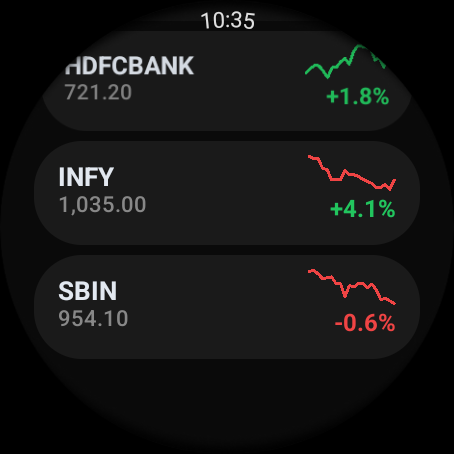 |

Each row carries the symbol, live price, a one-month sparkline and the day
change. The portfolio line at the top shows the equal-weighted average move —
tap it to refresh, tap the magnifier to search. Long-press a row to remove it.
Hard cap of 5 symbols.

The sparkline is coloured by **its own** direction, not by the day change beside
it. They cover different windows, so a red line next to a green percentage reads
correctly: down over the month, up today.

### Detail — four paged sections

Swipe horizontally between **Chart → Fundamentals → Returns → Risk**. Each page
scrolls vertically on its own, and the dot indicator shows where you are.

| Chart (1M) | Scrubbing | 1D intraday |
|---|---|---|
|  |  | 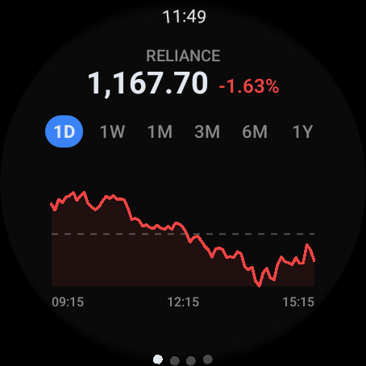 |

| Up period | 1Y | Fundamentals |
|---|---|---|
| 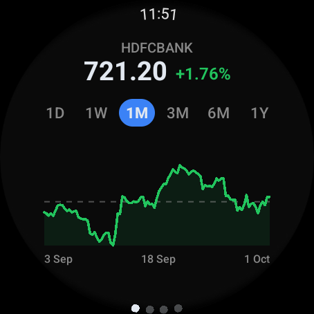 | 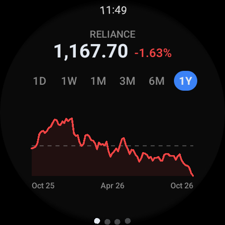 | 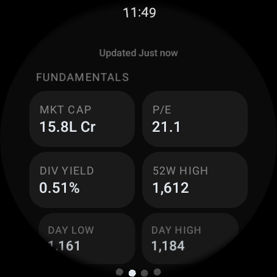 |

| Returns | Risk | Search |
|---|---|---|
| 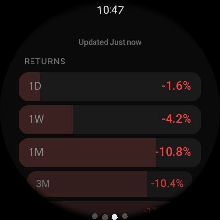 | 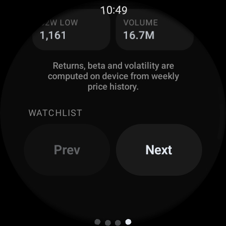 | 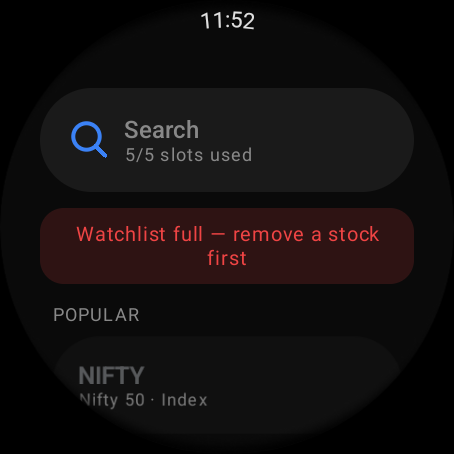 |

**Chart** — a price line over 1D / 1W / 1M / 3M / 6M / 1Y. One solid colour for
the whole period: green if it closed up, red if down. Flat area fill, a dashed
line at the period mean, and muted time/date labels at the left, middle and
right. Drag or tap anywhere on it to scrub — a marker dot and dashed guide
follow your finger while a floating tooltip shows the time/date and price. The
marker stays where you release it.

**Fundamentals** — market cap (in crore, as NSE quotes it), P/E, dividend yield,
52-week high, day low/high.

**Returns** — 1D / 1W / 1M / 3M / 6M / 1Y, each with a bar scaled to its magnitude.

**Risk** — beta vs Nifty, annualised volatility, 52-week low, volume, plus
Prev/Next to move between watchlist stocks.

### Removing and offline

| Remove | Offline (cached) | Offline, no cache |
|---|---|---|
| 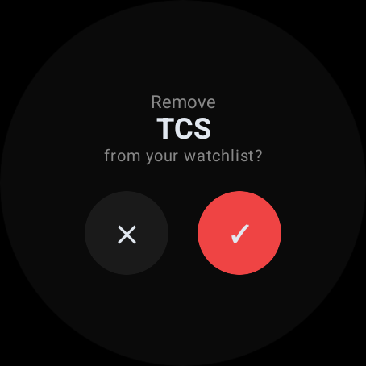 | 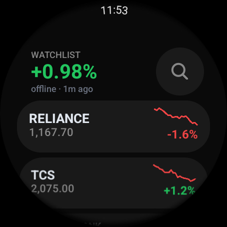 | 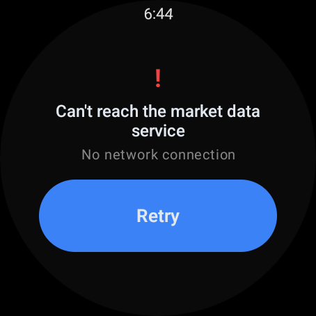 |

Offline, the app renders cached prices and sparklines with an honest
`offline · N min ago` marker. With nothing cached it shows a plain-language
error and a full-width Retry — never a blank screen or a raw exception.

A ~2 minute screen recording of the whole app is at
[`docs/walkthrough.mp4`](docs/walkthrough.mp4).

---

## Design notes — built for a circle, not a cropped rectangle

| Decision | Why |
|---|---|
| Home is a `ScalingLazyColumn`, never a plain list | It scales and fades rows as they approach the top and bottom of the circle, so nothing is abruptly clipped by the curve, and it drives the edge position indicator. |
| Detail is four pages, not one long column | Each page is about one screenful, so the dot indicator is a map of where you are rather than a scrollbar on a column that never ends. |
| The chart page does not scroll | The chart is why you opened that page. Everything on it is sized to fit one screenful, so it can never open with the chart below the fold. |
| One line colour per period, not per segment | A line that changes colour at every crossing reads as noise. The question this answers at a glance is "up or down over this window". |
| Straight segments, no smoothing | Real closes are jagged. A spline through them draws a pleasant curve that no price ever traded at. |
| Intraday intervals on 1W and 1M | A line through sixteen points is a smooth curve. Fetching 5-minute to 90-minute bars gives ~100 real closes, which is what makes it read as market data. |
| Thinning samples, never averages | Averaging adjacent closes is exactly what smooths away the chop. Every plotted point is a price that genuinely traded. |
| The chart claims drags on its own canvas | Scrubbing has to win over the page pager, or inspecting a price would flip to the next section. Paging is done above or below the plot. |
| 1D asks upstream for five days | A one-day window is empty on a weekend or market holiday. The extra sessions are trimmed to the most recent one, so the tab works on a Sunday. |
| Intraday labels forced to IST | These are NSE session times. Device-local time would print 04:15 for the opening bell to a traveller. |
| Removal is a full screen, not a dialog | A modal with two small buttons is the worst control to hit on a watch. |
| Sizes are fractions of the screen, floored at 48dp | Nothing is pinned to 466px. The chart page uses a deeper side inset than the others, because the plot sits low on the circle where the usable chord is narrower. |
| Dark only | True blacks cost less power on AMOLED, and one theme means one set of contrast decisions to get right. |
| Colour is never the only signal | Direction is carried by shape and sign as well as hue, and `contentDescription` is set on every interactive element. |

---

## Architecture

```
Room (source of truth)  ← the UI only ever observes this
      ↑ writes
StockRepository  →  Resource<T>  (Success / Error / Loading)
      ↑
MarketDataSource  →  Yahoo Finance web endpoints, direct from the watch
```

- **Room is the source of truth.** Screens observe `Flow`s, so a cold start
  paints instantly from cache and a failed network call can never blank the
  screen.
- **Every exception is caught at the repository boundary** and converted to
  `Resource.Error`. No ViewModel or composable handles `IOException`.
- **Partial failure degrades per symbol** — four good rows plus one greyed one,
  never an app-wide error.
- **Batched fetch** — one quote call covers the whole watchlist, with a
  per-symbol fallback for anything the batch misses.
- **Returns, beta and volatility are computed on device** from one year of daily
  closes, sampled weekly for the risk stats. They are derived, not scraped,
  which is why they can be shown honestly. Anything that cannot be computed
  renders as an em dash — nothing is invented to fill a gap.
- **Chart series are cached in memory**, sparkline trends in Room. A month of
  daily closes barely moves within a few hours, so the common refresh stays one
  batched call.

### Sync cadence

The original spec asked for a 5-minute background sync. Android enforces a
**15-minute floor** on `PeriodicWorkRequest` — a platform constraint, not a
library one. Freshness is delivered in two parts:

- `PriceSyncWorker` runs at the floor to keep the cache warm for a cold open;
- every screen open, and a tap on the watchlist average, refreshes on the spot.

### Data source, honestly

Market data comes from Yahoo Finance's public web endpoints — free, no API key,
**unofficial**, and **delayed 15 minutes** for NSE/BSE (the feed reports
`exchangeDataDelayedBy: 15`, `quoteSourceName: "Delayed Quote"`). Fine for
glancing at a watchlist; not something to trade on. The app never claims to use
an official Yahoo API.

Symbols: NSE `.NS` (`RELIANCE.NS`), BSE `.BO`, indices `^NSEI` / `^BSESN`.

An optional Flask proxy lives in [`backend/`](backend/) if you would rather
centralise caching and rate limiting — point `BASE_URL` in
`data/remote/ApiClient.kt` at it and nothing in the UI layer changes.

---

## Build from source

Requires JDK 17 and the Android SDK (platform 34, build-tools 34.0.0).

```bash
cd android
./gradlew assembleDebug      # app/build/outputs/apk/debug/app-debug.apk
./gradlew assembleRelease    # app/build/outputs/apk/release/app-release.apk
```

`assembleRelease` picks up `android/keystore.properties` if present and falls
back to the debug key otherwise, so it always produces something installable.

> **Signing material is not in this repo and must not be.** `*.keystore` and
> `keystore.properties` are gitignored. Keep your copies safe — Android will
> refuse an update signed with a different key.

Release builds run R8 with `isMinifyEnabled` and `isShrinkResources`: **2.67 MB**
against the spec's 45 MB budget.

---

## Verified

Run on a round Wear OS 4 emulator at **454×454** — deliberately not 466, to
prove nothing is pixel-pinned — against live NSE data:

- Home list, scrolling, portfolio average, per-stock sparklines.
- Chart: jagged line for every period tab, both colour cases, area fill, mean
  line, axis labels; drag and single-tap scrubbing; selection persisting on
  release; period switches regenerating the series.
- Paging across all four sections with vertical scroll inside each.
- Prev/Next switching stock, with Prev disabled on the first.
- Long-press removal with confirm; search, add, and the 5/5 full notice.
- Offline: cold start on cache with the staleness marker; "Chart unavailable"
  while fundamentals still render; no-cache error and Retry recovery.
- Release build (R8) with zero crashes — minification does not break Moshi or Room.
- `PriceSyncWorker` confirmed enqueued with JobScheduler.

### Known limitations

- Prices are **15 minutes delayed** (see above).
- For the first few minutes after the 9:15 IST open, the 1D tab may show
  "Chart unavailable" until two 5-minute bars exist.
- FII/DII/promoter shareholding is **absent, not mocked** — the data source does
  not provide it. Beta and volatility fill that panel with real computed numbers
  instead.
- The live intraday path was verified against a completed session; the
  "chart growing in real time" behaviour has not yet been watched during
  market hours.

---

## Project layout

```
StockWearOS/
├── release/            signed APK, ready to install
├── screenshots/        the images used above
├── docs/
│   ├── walkthrough.mp4 screen recording of the whole app
│   └── specs/          the specs this was built against
├── android/            Wear OS app (Kotlin + Compose)
│   └── app/src/main/kotlin/com/siddharth/stockticker/
│       ├── navigation/  SwipeDismissableNavHost graph
│       ├── ui/          home, detail, search, components, theme
│       ├── data/        local (Room), remote (Retrofit), repository
│       ├── sync/        PriceSyncWorker
│       └── util/        formatters, series stats, Resource, connectivity
└── backend/            optional Flask proxy
```

Read-only market data throughout. No trading, no order placement, no brokerage
linkage, no login, no PII.

## License

See [LICENSE](LICENSE).
